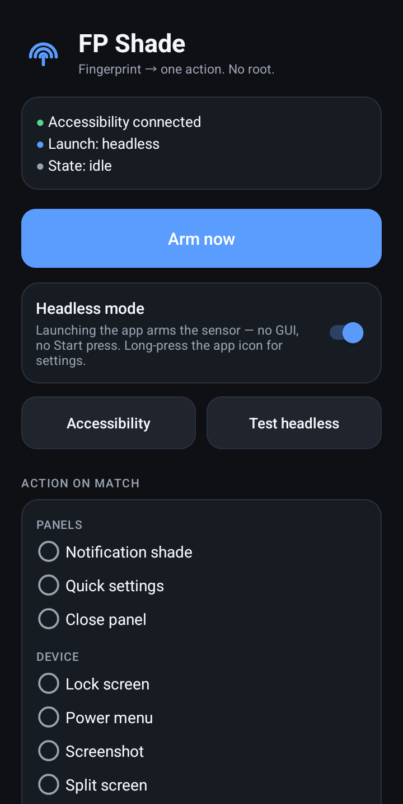
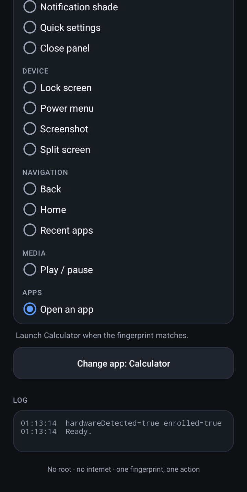
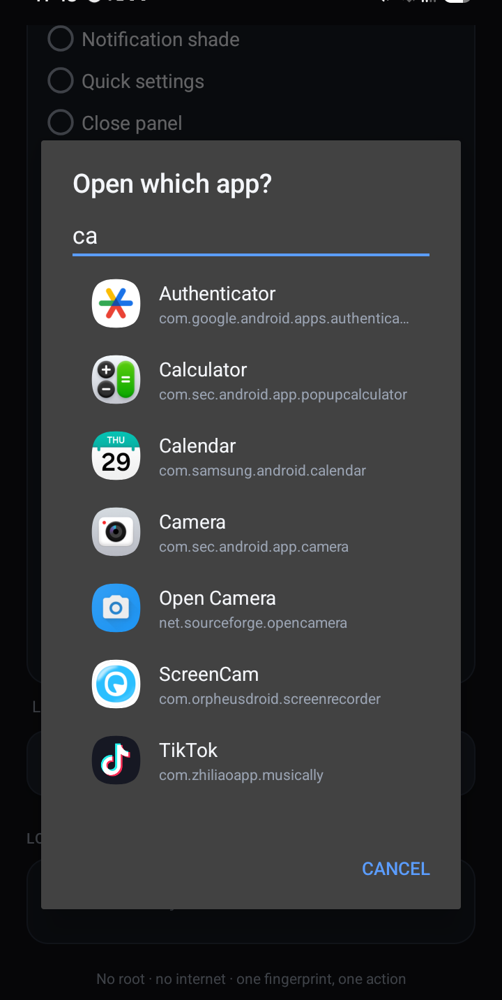

# FP Shade

**Fingerprint → one action. No root, no Xposed, no background listener.**

FP Shade uses your phone's own fingerprint sensor to trigger a single action: pull
down the notification shade, open quick settings, lock the screen, take a
screenshot, open the power menu — or launch an app of your choice. It is built on
the accessibility API, so nothing needs to be rooted or patched.

> **Tested on:** Samsung Galaxy A17 (SM-A176B, Android 17). It should work on
> other Android 8.0+ phones with a fingerprint sensor, but silent fingerprint
> authentication is implemented differently by some manufacturers — see
> [Compatibility](#compatibility).

<p align="center">
  
  
  
</p>

## Features

- **No root.** A normal app with two fingerprint permissions and an
  accessibility service.
- **Silent one-shot.** One trigger arms exactly one fingerprint session; a match
  fires exactly one action and disarms. Nothing listens in the background.
- **Headless mode.** Launching the app arms the sensor with no UI at all. Bind it
  to the side key (double press) and a touch is all it takes.
- **12 actions.** Panels, device controls, navigation, media, plus launching any
  installed app.
- **Searchable app picker.** Find the app you want by name or package; icons are
  cached so long lists scroll smoothly.
- **No internet permission.** Nothing leaves the device.
- **Dark, readable settings screen.** Long-press the app icon → *FP Shade
  settings* to open it at any time.

## Actions

| Section | Action |
| --- | --- |
| Panels | Notification shade, Quick settings, Close panel |
| Device | Lock screen, Power menu, Screenshot, Split screen |
| Navigation | Back, Home, Recent apps |
| Media | Play / pause |
| Apps | Open an app (any installed app) |

Actions that your Android version does not support are hidden automatically.
Launching an app does **not** need accessibility; the system actions do.

## Install

1. Download the APK from [Releases](https://github.com/plumbark/FP-Shade/releases/latest).
2. Allow installing unknown apps for your browser/file manager when prompted.
3. Open **FP Shade**.

The APK is signed with the project's release key. Future updates must be signed
with the same key to install over this one.

## Setup

1. In FP Shade, tap **Accessibility** and enable **FP Shade** under
   *Settings → Accessibility*. The accessibility service is only used to call
   `performGlobalAction`; it never reads window content.
2. Pick the action you want.
3. *(Optional, Samsung)* Bind it to the side key:
   *Settings → Advanced features → Side button → Double press → Open app → FP Shade*.
   The exact menu name varies by One UI version; any launcher shortcut or gesture
   that starts the app works.
4. Turn on **Headless mode**.

With headless mode on, starting FP Shade shows nothing: the sensor is armed for
10 seconds, one match fires the action, and the app closes. Reopen the settings
with a long-press on the app icon → **FP Shade settings**.

## How it works

1. A transparent activity arms one session with the legacy `FingerprintManager`
   API (the only prompt-free fingerprint API available without root).
2. On a match it performs exactly one action: an accessibility global action, or
   an explicit app launch.
3. It disarms and finishes.

The app is single-shot on purpose: a re-arming loop would fight with the system
fingerprint UI and drain the sensor. Because nothing runs in the background, the
sensor is only armed while the trigger activity is in front and for at most 10
seconds.

## Compatibility

- **Minimum:** Android 8.0 (API 26). Some actions require newer versions and are
  hidden on older devices.
- **Tested:** Samsung Galaxy A17, Android 17.
- **Caveat:** some manufacturers draw their own fingerprint overlay or block
  silent (non-`BiometricPrompt`) authentication. That cannot be suppressed by a
  normal app. If a system fingerprint dialog appears on your device, this app
  cannot remove it without root.
- After several failed touches Android temporarily locks the sensor. FP Shade
  stops after a few failures to avoid triggering a long lockout.

## Privacy

- No `INTERNET` permission — the app cannot send data anywhere.
- No analytics, accounts, or ads.
- Settings are stored in the app's private storage.
- The accessibility service reads no window content and keeps no history.

## Build from source

The project deliberately avoids Gradle; it builds with the Android SDK
command-line tools.

Requirements:

- JDK 17+
- Android SDK platform 34 (`platforms/android-34/android.jar`)
- `aapt2`, `d8`, `apksigner`, `zip` on `PATH` (Android SDK build-tools 34, or the
  equivalent packages on Termux)

```bash
export ANDROID_HOME=/path/to/android-sdk   # or ANDROID_SDK_ROOT
./build.sh
```

The output is `fpshade.apk` in the project root.

### Signing

For a distributable build, create a keystore and a `keystore.properties` file
(both are git-ignored):

```bash
keytool -genkeypair -keystore release.keystore -alias fpshade \
    -keyalg RSA -keysize 4096 -validity 10000

cp keystore.properties.example keystore.properties
# edit keystore.properties: set the password for store and key
./build.sh
```

Without `keystore.properties`, the script falls back to a local debug key and
warns that the APK must not be distributed.

### Versioning

Change `versionCode` / `versionName` in `AndroidManifest.xml`, build, then tag the
release with the same version.

## License

[MIT](LICENSE)

Not affiliated with Samsung, Google, or Android.
